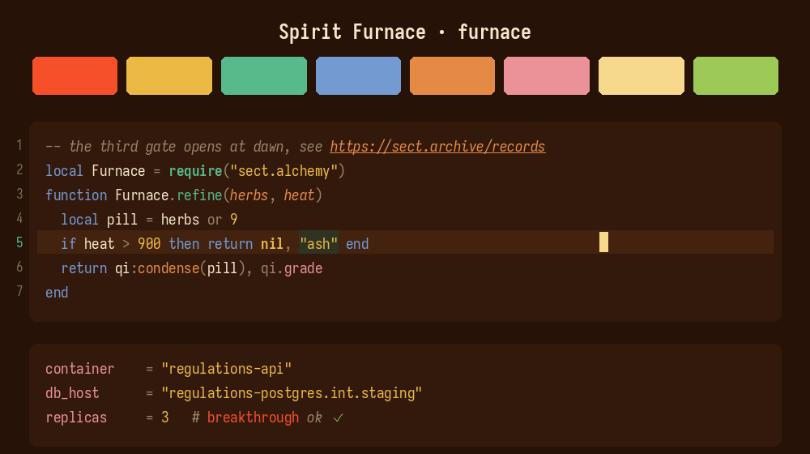
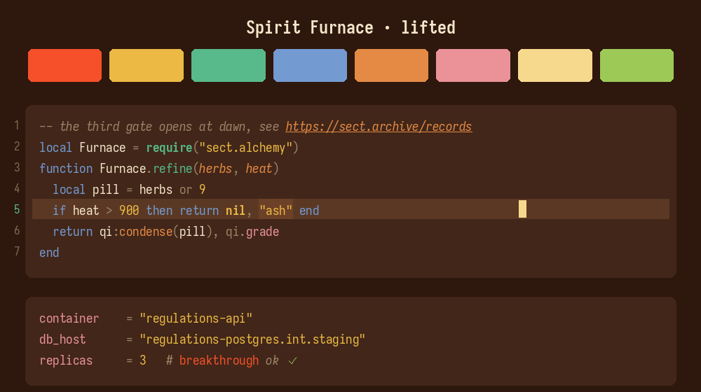
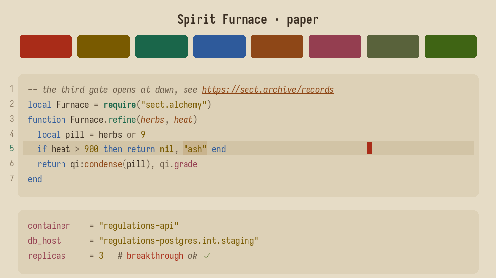

# Spirit Furnace

A warm theme set for nvim, terminals, git tools, the prompt and the WM, built
around a cultivator's pill furnace. Calm mineral pigments from blue-green
landscape painting carry the code; boldness is saved for what has to cut through
(errors, cursor, search, git state). Gentler than its sibling
[static-gospel](https://github.com/srlightbody/static-gospel), whose build
system it shares.

## Palette

| Role | furnace | paper | Use |
|---|---|---|---|
| base (bg) | `#261207` | `#c9b98f` | lacquered rosewood / old scroll |
| text | `#f6e7cb` | `#2d2216` | scripture |
| incense | `#75907a` | `#5e503d` | comments, operators |
| ash | `#627665` | `#7c6c56` | line numbers, quiet chrome |
| heaven | `#749ad2` | `#1d4988` | keywords (azurite sky) |
| jade | `#58b98a` | `#00563b` | functions (qi) |
| elixir | `#ebb944` | `#634500` | strings, numbers, constants (gamboge pills) |
| blossom | `#cc95dc` | `#673575` | types, properties (wisteria) |
| furnace | `#e48a45` | `#7b3600` | params, directives, links (refining fire) |
| core | `#a9e3c9` | `#683f4c` | titles, directories, focus (celadon qi glow; ink-lacquer on paper) |
| tribulation | `#f5502a` | `#951300` | errors (cinnabar) |
| herb | `#9dc957` | `#305400` | added, ok (spirit herb) |
| cursor | `#a9e3c9` | `#951300` | qi glow / cinnabar seal |
| bar | `#1c3d2d` | `#adab83` | prompt bar (ink jade) |

### 16-color ANSI (furnace)

```
normal   0 #35442e  1 #f5502a  2 #9dc957  3 #ebb944  4 #749ad2  5 #cc95dc  6 #58b98a  7 #dcceb4
bright   8 #627665  9 #ff795a 10 #bae183 11 #ffd579 12 #92b3e4 13 #e2b2f0 14 #81d0a6 15 #f6e7cb
```

## Variants

| Variant | base | feel |
|---------|-----------|-----------------------|
| furnace *(default)* | `#261207` | lacquered rosewood brown, lit from the furnace |
| lifted | `#2e170c` | furnace, tuned for a basic laptop LCD |
| paper | `#c9b98f` | old yellowed scroll, dim light |





**Neovim** picks the variant at runtime. With the default `variant = "auto"`,
`set background=light` gives paper and dark gives furnace:

```lua
require("spirit-furnace").setup({ variant = "lifted" }) -- furnace (default), lifted, paper
vim.cmd.colorscheme("spirit-furnace")
```

**Everything else** ships one file per variant next to the default, e.g.
`ghostty/spirit-furnace-lifted`, `bat/spirit-furnace-paper.tmTheme`, or
`brave/spirit-furnace-paper/`. Point your app at that instead.

## Building

Every app file is generated from `palette.toml`. Don't hand edit them, edit
`palette.toml` (or `build/templates/*.tmpl` for structure) and rebuild:

```bash
python build/build.py            # regenerate every app file + palette.lua
python build/build.py check      # fail if any file is out of sync (CI/pre-commit)
python build/preview.py          # regenerate assets/preview-*.png (needs Pillow)
```

Every variant sets ten ramp roles (`base`/`surface`/`overlay`/`_nc`, the three
highlight grays, `inactive_tab`/`border`/`selection`), a display name, and
optionally `mode = "light"`. A variant can also override individual accents or
bright ANSI colors in `[variants.<name>.accents]` / `[variants.<name>.bright]`,
as paper does.

## Install

One file per app, no clone needed (except brave). Replace the raw URL base if
you fork it.

### Neovim

No dependencies, the plugin manager handles it. With lazy.nvim:

```lua
{
	"srlightbody/spirit-furnace",
	lazy = false,
	priority = 1000,
	config = function()
		vim.cmd.colorscheme("spirit-furnace")
	end,
}
```

packer:

```lua
use({ "srlightbody/spirit-furnace" })
-- then: vim.cmd.colorscheme("spirit-furnace")
```

### Ghostty

Drop it in ghostty's themes dir and point at it:

```sh
mkdir -p ~/.config/ghostty/themes
curl -fsSL https://raw.githubusercontent.com/srlightbody/spirit-furnace/main/ghostty/spirit-furnace \
	-o ~/.config/ghostty/themes/spirit-furnace
```

```
# ~/.config/ghostty/config
theme = spirit-furnace
```

Reload with `ctrl+shift+,` (or `cmd+shift+,` on macOS).

### Alacritty (0.13+)

```sh
mkdir -p ~/.config/alacritty/themes
curl -fsSL https://raw.githubusercontent.com/srlightbody/spirit-furnace/main/alacritty/spirit-furnace.toml \
	-o ~/.config/alacritty/themes/spirit-furnace.toml
```

```toml
# ~/.config/alacritty/alacritty.toml
[general]
import = ["~/.config/alacritty/themes/spirit-furnace.toml"]
```

### tmux

```sh
curl -fsSL https://raw.githubusercontent.com/srlightbody/spirit-furnace/main/tmux/spirit-furnace.conf \
	-o ~/.config/tmux/spirit-furnace.conf
```

```
# ~/.config/tmux/tmux.conf
source-file ~/.config/tmux/spirit-furnace.conf
```

Reload with `tmux source-file ~/.config/tmux/tmux.conf`.

### powerlevel10k

Overrides the colors in your existing `~/.p10k.zsh`, collapsing the rainbow
segments onto one bar with hot accent text. Source it after p10k's own config:

```sh
mkdir -p ~/.config/zsh
curl -fsSL https://raw.githubusercontent.com/srlightbody/spirit-furnace/main/p10k/spirit-furnace.zsh \
	-o ~/.config/zsh/spirit-furnace.zsh
```

```sh
# ~/.zshrc, after sourcing ~/.p10k.zsh
source ~/.config/zsh/spirit-furnace.zsh
```

### Brave / Chromium

Theme extension, so it needs the whole folder for the variant you want:

```sh
git clone https://github.com/srlightbody/spirit-furnace ~/.spirit-furnace
```

Open `brave://extensions` (or `chrome://extensions`), enable Developer mode, click
"Load unpacked", and select `~/.spirit-furnace/brave` for the default (furnace)
theme, `brave/spirit-furnace-lifted` for the LCD adaptation, or
`brave/spirit-furnace-paper` for the light one. Each is a
separate extension; to switch, load
the new one and disable the old on the extensions page.

### foot

```sh
curl -fsSL https://raw.githubusercontent.com/srlightbody/spirit-furnace/main/foot/spirit-furnace.ini \
	-o ~/.config/foot/spirit-furnace.ini
```

```ini
# ~/.config/foot/foot.ini
include=~/.config/foot/spirit-furnace.ini
```

### kitty

```sh
curl -fsSL https://raw.githubusercontent.com/srlightbody/spirit-furnace/main/kitty/spirit-furnace.conf \
	-o ~/.config/kitty/spirit-furnace.conf
```

```conf
# ~/.config/kitty/kitty.conf
include ./spirit-furnace.conf
```

### wezterm

```sh
mkdir -p ~/.config/wezterm/colors
curl -fsSL https://raw.githubusercontent.com/srlightbody/spirit-furnace/main/wezterm/spirit-furnace.toml \
	-o ~/.config/wezterm/colors/spirit-furnace.toml
```

```lua
-- wezterm.lua
config.color_scheme = "Spirit Furnace"
```

### bat

```sh
mkdir -p "$(bat --config-dir)/themes"
curl -fsSL https://raw.githubusercontent.com/srlightbody/spirit-furnace/main/bat/spirit-furnace.tmTheme \
	-o "$(bat --config-dir)/themes/spirit-furnace.tmTheme"
bat cache --build
```

```sh
# ~/.config/bat/config
--theme="spirit-furnace"
```

### delta

Needs the bat theme above (delta uses bat's syntax themes).

```sh
curl -fsSL https://raw.githubusercontent.com/srlightbody/spirit-furnace/main/delta/spirit-furnace.gitconfig \
	-o ~/.config/delta/spirit-furnace.gitconfig
```

```ini
# ~/.gitconfig
[include]
	path = ~/.config/delta/spirit-furnace.gitconfig
```

### lazygit

Layer it over your config so updates don't touch your own settings:

```sh
curl -fsSL https://raw.githubusercontent.com/srlightbody/spirit-furnace/main/lazygit/spirit-furnace.yml \
	-o ~/.config/lazygit/spirit-furnace.yml
```

```sh
# in your shell rc (rightmost file wins)
export LG_CONFIG_FILE="$HOME/.config/lazygit/config.yml,$HOME/.config/lazygit/spirit-furnace.yml"
```

### k9s

```sh
mkdir -p ~/.config/k9s/skins
curl -fsSL https://raw.githubusercontent.com/srlightbody/spirit-furnace/main/k9s/spirit-furnace.yaml \
	-o ~/.config/k9s/skins/spirit-furnace.yaml
```

```yaml
# ~/.config/k9s/config.yaml
k9s:
  ui:
    skin: spirit-furnace
```

### lsd

```sh
curl -fsSL https://raw.githubusercontent.com/srlightbody/spirit-furnace/main/lsd/spirit-furnace.yaml \
	-o ~/.config/lsd/colors.yaml
```

lsd only reads `colors.yaml`, so for a variant save its file (e.g.
`lsd/spirit-furnace-lifted.yaml`) to that same path.

### Noctalia

Drop it in noctalia's colorschemes folder and pick it in settings, noctalia
generates the per-terminal files itself:

```sh
mkdir -p ~/.config/noctalia/colorschemes
cp -r "noctalia/colorschemes/Spirit Furnace" ~/.config/noctalia/colorschemes/
```

### umbriel

Colors only (borders, tab bar, overview, hints), layered over your own config:

```sh
curl -fsSL https://raw.githubusercontent.com/srlightbody/spirit-furnace/main/umbriel/spirit-furnace.toml \
	-o ~/.config/umbriel/spirit-furnace.toml
```

```toml
# ~/.config/umbriel/config.toml, theme last so it wins
[include]
files = ["/usr/share/umbriel/config.toml", "~/.config/umbriel/spirit-furnace.toml"]
```

## Notes

- The neovim theme vendors rose-pine/neovim's highlight engine (MIT, see
  LICENSE) and drives it off the palette above. No runtime dependency.
- ANSI: 4/12 heaven (blue), 5/13 blossom (magenta), 6/14 jade (cyan). `furnace`
  and `core` have no ANSI slot; nvim accents and the 16-color ANSI don't have
  to match.
- Paper is a dim, yellowed scroll (well below white). Every pigment is re-fit to
  roughly 4.5:1 on it, and its `core` is ink-lacquer instead of celadon, since
  greens and golds crowd at that contrast.
